# Solutions for Exercises-09-AWS-Services

## Exercise 1

> Notice: I used the 'TWN_' pretag for naming the user and the group.

**The new user's permissions:**

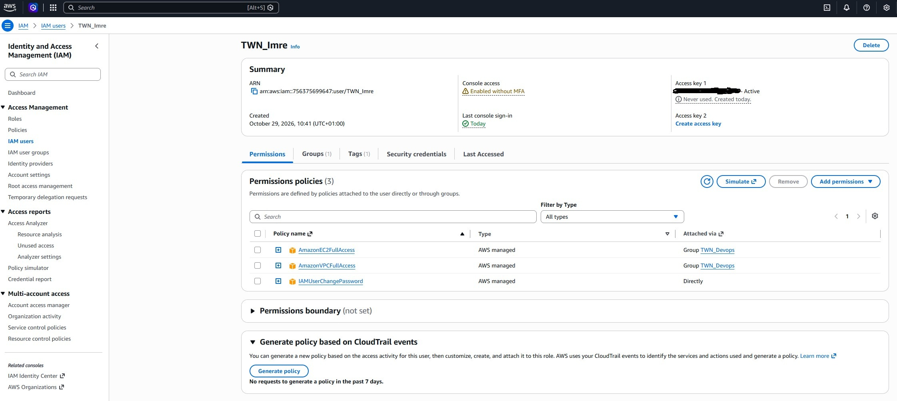

**The new user's groups:**

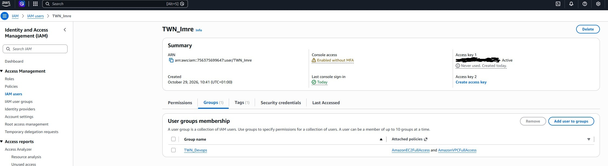

**The new group's users:**

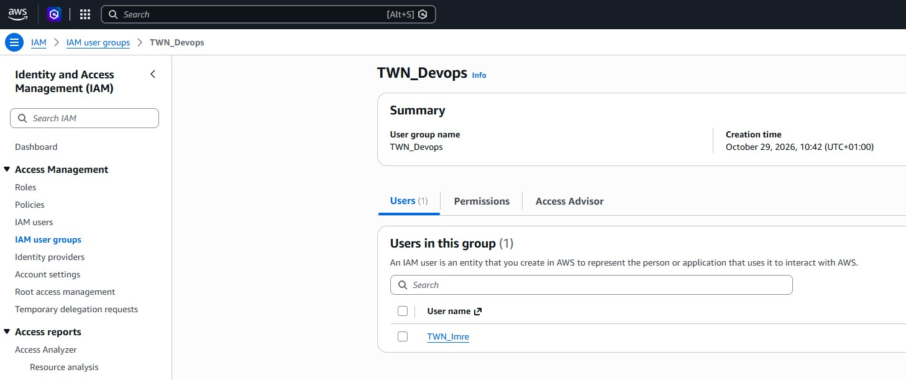

**The new group's permissions:**

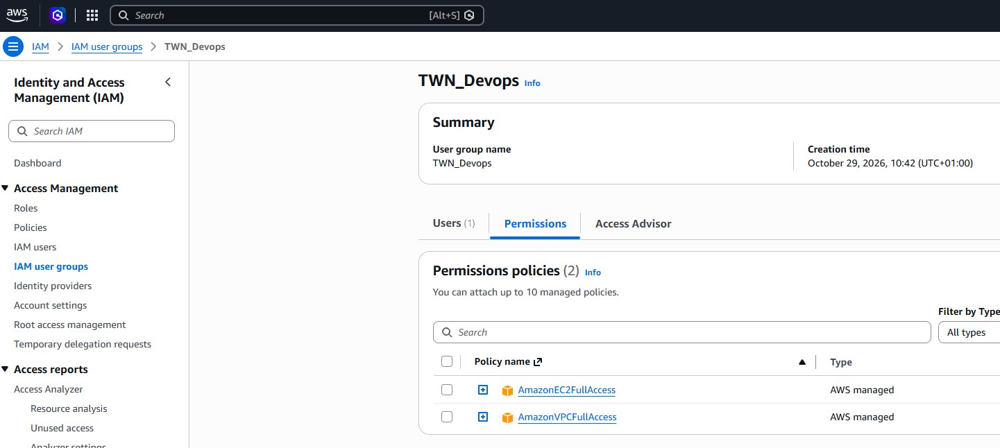

## Exercise 2

**To configure AWS CLI I used these commands:**

```bash
aws configure
AWS Access Key ID [****]: MY_ACCESS_KEY
AWS Secret Access Key [****]: MY_SECRET_ACCESS_KEY
Default region name [eu-north-1]: ENTER
Default output format [json]: ENTER

# To test the connection.
aws s3 ls
```

## Exercise 3

**Commands for the steps of this exercise:**

```bash
# Create VPC & Subnet
aws ec2 create-vpc --cidr-block 10.0.0.0/16 --query Vpc.VpcId --output text --tag-specifications ResourceType=vpc,Tags=[{Key=Name,Value=VpcTwnDevOpsExercises9}]
aws ec2 create-subnet --vpc-id vpc-0c14974f8c371a434 --cidr-block 10.0.1.0/24 --availability-zone eu-north-1a --query Subnet.SubnetId --output text --tag-specifications ResourceType=subnet,Tags=[{Key=Name,Value=SubnetTwnDevOpsExercises9}]

# Create & attach Internet Gateway
aws ec2 create-internet-gateway --query InternetGateway.InternetGatewayId --output text --tag-specifications ResourceType=internet-gateway,Tags=[{Key=Name,Value=IgTwnDevOpsExercises9}]
aws ec2 attach-internet-gateway --vpc-id vpc-0c14974f8c371a434 --internet-gateway-id igw-0dea9f4f2279ca1e9

# Create Route Table & Route
aws ec2 create-route-table --vpc-id vpc-0c14974f8c371a434 --query RouteTable.RouteTableId --output text --tag-specifications ResourceType=route-table,Tags=[{Key=Name,Value=RtbTwnDevOpsExercises9}]
aws ec2 create-route --route-table-id rtb-04e3090d846e9e91f --destination-cidr-block 0.0.0.0/0 --gateway-id igw-0dea9f4f2279ca1e9
aws ec2 associate-route-table --route-table-id rtb-04e3090d846e9e91f --subnet-id subnet-0e2ce8a0bd58161d9

# Create Security Group
aws ec2 create-security-group --group-name SgTwnDevOpsExercises9 --description "This Subnet is for TWN DevOps Bootcamp Exercise 9" --vpc-id vpc-0c14974f8c371a434 --tag-specifications ResourceType=security-group,Tags=[{Key=Name,Value=SgTwnDevOpsExercises9}]
aws ec2 authorize-security-group-ingress --group-id sg-0f9a9c47a4d834139 --protocol tcp --port 22 --cidr 0.0.0.0/0
```

**The new VPC:**

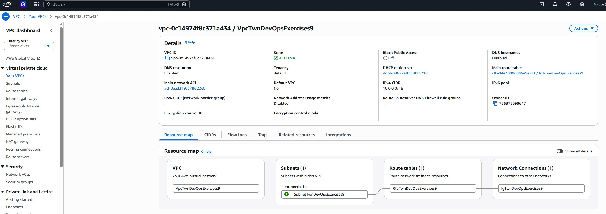

**The new Subnet:**

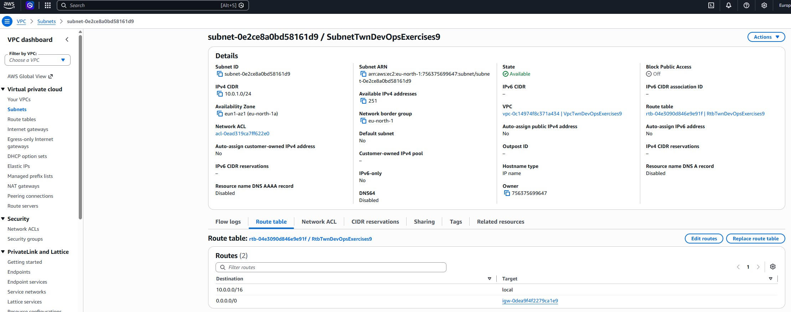

**The new Internet Gateway:**

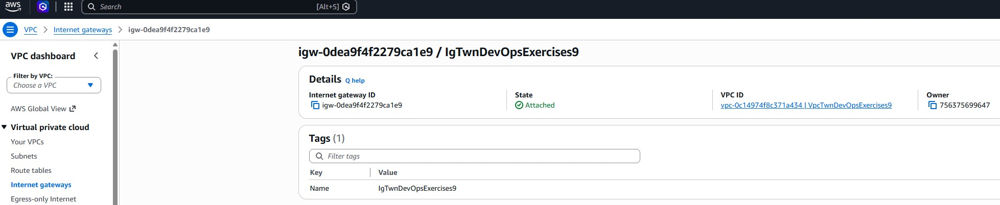

**The new Route Table:**

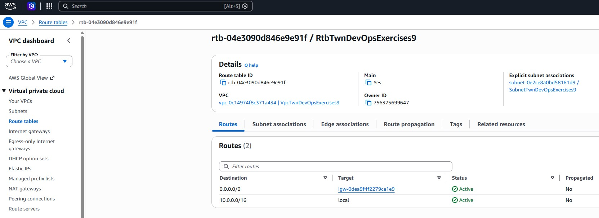

**The new Security Group:**

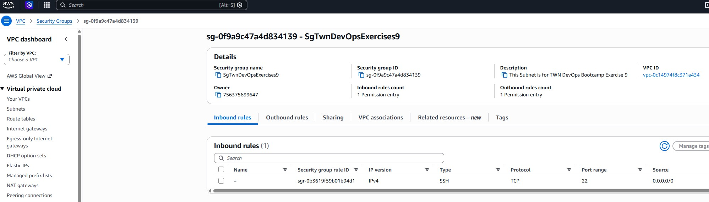

## Exercise 4

```bash
aws ec2 create-key-pair --key-name TwnDevOpsExercise9 --query 'KeyMaterial' --output text > TwnDevOpsExercise9.pem
chmod 400 TwnDevOpsExercise9.pem

aws ec2 run-instances --image-id ami-021aaf3749be66813 --count 1 --instance-type t3.micro --key-name TwnDevOpsExercise9 --security-group-ids sg-0f9a9c47a4d834139 --subnet-id subnet-0e2ce8a0bd58161d9 --tag-specifications 'ResourceType=instance,Tags=[{Key=Name,Value=Ec2TwnDevOpsExercises9}]' --associate-public-ip-address
```

**The new EC2 instance:**

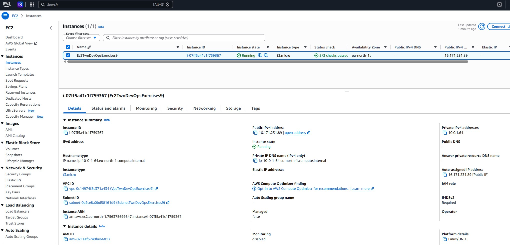

## Exercise 5

**These are the steps I used to log in to my new EC2 instance:**

```bash
ssh -i ~/.ssh/TwnDevOpsExercise9.pem ubuntu@MY_EC2_IP_ADDRESS

sudo apt update
sudo apt install docker.io

sudo usermod -aG docker ubuntu
docker --version
```

## Exercise 6

> Important!
> I cloned the example repository, and copied the files and folder into this project.
> I also added the Dockerfile and the Jenkinsfile from the previous project to this one.

**This is the content of the docker-compose.yaml file:**

```yaml
version: "3.9"
name: twn-dc

services:

  my-nodejs-app:
    image: ${IMAGE_NAME}
    container_name: twn-nodejs-app-for-aws
    ports:
      - 3000:3000
```

## Exercise 7

**At first I had to install Docker Compose in the EC2 instance:**

```bash
ssh -i ~/.ssh/TwnDevOpsExercise9.pem ubuntu@MY_EC2_IP_ADDRESS

sudo apt update
sudo apt install docker-compose-v2
docker compose version
```

**After that I created the /etc/docker/daemon.json file with the neccessary content:**

```json
{
  "insecure-registries": ["NEXUS_ADDRESS:8082"]
}
```

**And I restarted Docker and logged in to Nexus:**

```bash
sudo systemctl restart docker

docker login -u NEXUS_USER NEXUS_ADDRESS:8082
```

**The new deploy stage in Jenkinsfile:**

```groovy
stage("DeployToEC2") {
    steps {
        script {
            echo "----- DEPLOYING TO AWS EC2 INSTANCE -----"

            env.IMAGE_NAME = "${NEXUS_ADDRESS}/${APP_NAME}:${NEW_VERSION}"
            echo "FULL IMAGE NAME: ${IMAGE_NAME}"

            sshagent(['twn-exercise-9']) {
                def ec2Instance = "ubuntu@MY_EC2_IP_ADDRESS"
                def shellCommand = "bash ./run-docker-compose.sh ${IMAGE_NAME}"

                sh "scp -o StrictHostKeyChecking=no run-docker-compose.sh ${ec2Instance}:/home/ubuntu"
                sh "scp -o StrictHostKeyChecking=no docker-compose.yaml ${ec2Instance}:/home/ubuntu"
                sh "ssh -o StrictHostKeyChecking=no ${ec2Instance} ${shellCommand}"
            }
        }
    }
}
```

**The content of run-docker-compose.sh:**

```bash
#!/user/bin/bash

export IMAGE_NAME=$1

docker compose -f docker-compose.yaml up -d

echo "--- DOCKER COMPOSE STARTED ---"
```

**The successful pipeline run with deployment in Jenkinsfile:**

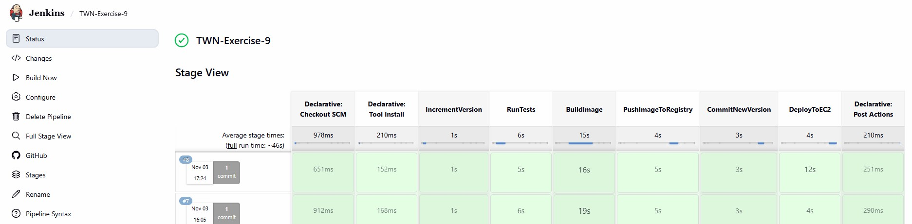

**The docker compose successfully started on my EC2 instance:**

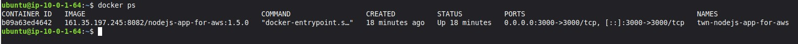

## Exercise 8

**I used this command to open a port for the NodeJS app:**

```bash
aws ec2 authorize-security-group-ingress --group-id MY_SG_ID --protocol tcp --port 3000 --cidr 0.0.0.0/0
```

**The app is accessible in the browser after the port is opened:**

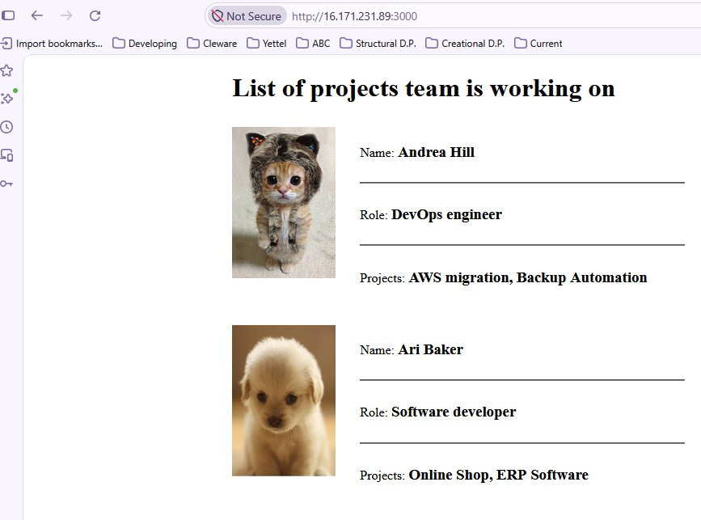

## Exercise 9

**I created a new pipeline as a Multibranch pipeline, and I disabled the original one (which was a normal Pipeline).**
**TEST**
