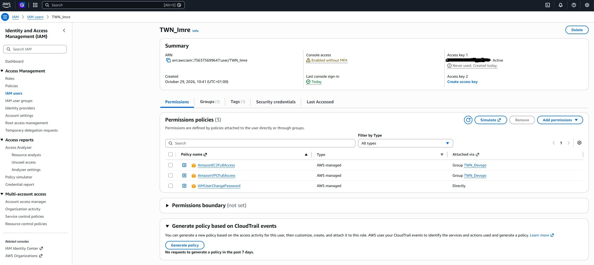
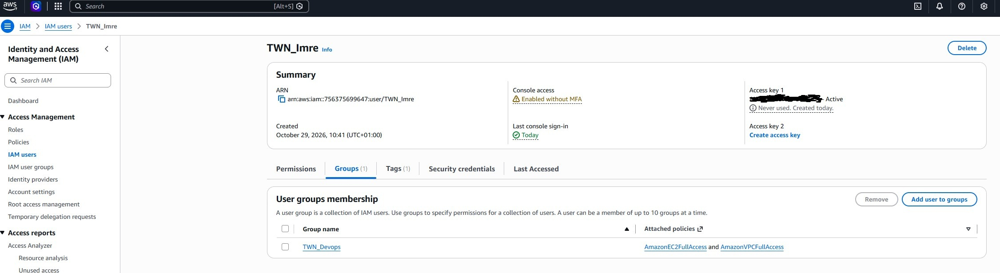
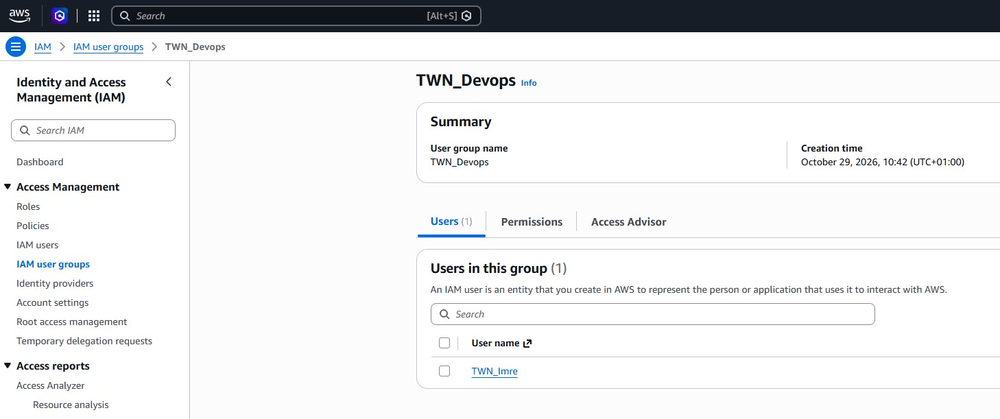
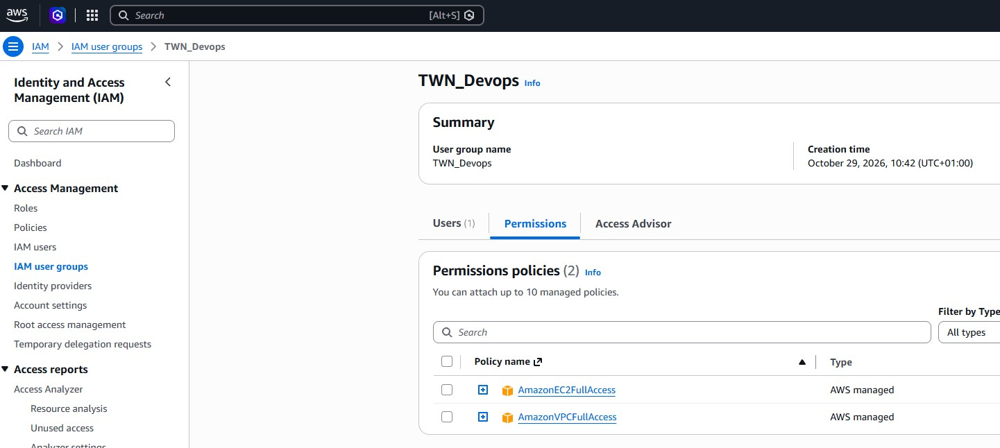
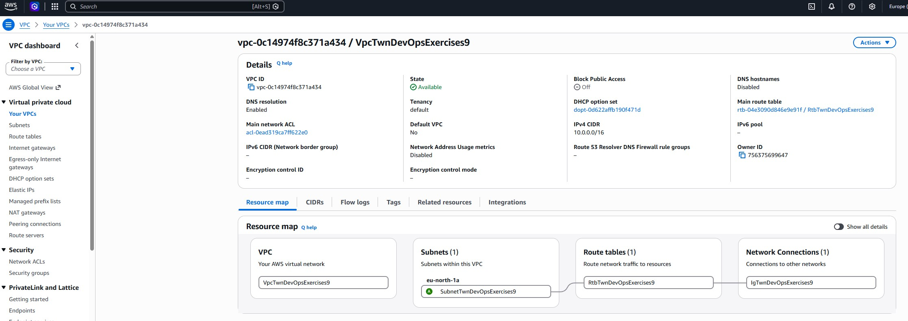
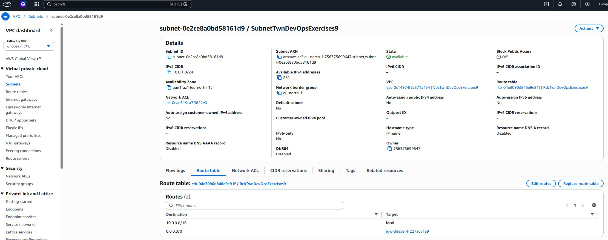
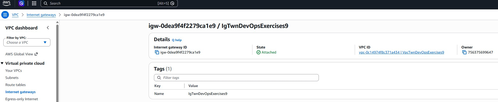
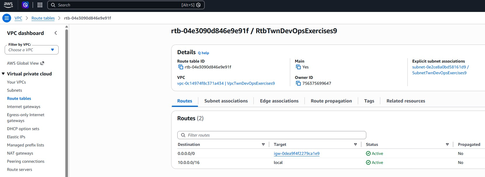
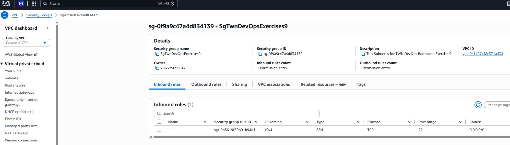

# Solutions for Exercises-09-AWS-Services

## Exercise 1

> Notice: I used the 'TWN_' pretag for naming the user and the group.

**The new user's permissions:**



**The new user's groups:**



**The new group's users:**



**The new group's permissions:**



## Exercise 2

**To configure AWS CLI I used these commands:**

```bash
aws configure
AWS Access Key ID [****]: MY_ACCESS_KEY
AWS Secret Access Key [****]: MY_SECRET_ACCESS_KEY
Default region name [eu-north-1]: ENTER
Default output format [json]: ENTER

# To test the connection.
aws s3 ls
```

## Exercise 3

**Commands for the steps of this exercise:**

```bash
# Create VPC & Subnet
aws ec2 create-vpc --cidr-block 10.0.0.0/16 --query Vpc.VpcId --output text --tag-specifications ResourceType=vpc,Tags=[{Key=Name,Value=VpcTwnDevOpsExercises9}]
aws ec2 create-subnet --vpc-id vpc-0c14974f8c371a434 --cidr-block 10.0.1.0/24 --availability-zone eu-north-1a --query Subnet.SubnetId --output text --tag-specifications ResourceType=subnet,Tags=[{Key=Name,Value=SubnetTwnDevOpsExercises9}]

# Create & attach Internet Gateway
aws ec2 create-internet-gateway --query InternetGateway.InternetGatewayId --output text --tag-specifications ResourceType=internet-gateway,Tags=[{Key=Name,Value=IgTwnDevOpsExercises9}]
aws ec2 attach-internet-gateway --vpc-id vpc-0c14974f8c371a434 --internet-gateway-id igw-0dea9f4f2279ca1e9

# Create Route Table & Route
aws ec2 create-route-table --vpc-id vpc-0c14974f8c371a434 --query RouteTable.RouteTableId --output text --tag-specifications ResourceType=route-table,Tags=[{Key=Name,Value=RtbTwnDevOpsExercises9}]
aws ec2 create-route --route-table-id rtb-04e3090d846e9e91f --destination-cidr-block 0.0.0.0/0 --gateway-id igw-0dea9f4f2279ca1e9
aws ec2 associate-route-table --route-table-id rtb-04e3090d846e9e91f --subnet-id subnet-0e2ce8a0bd58161d9

# Create Security Group
aws ec2 create-security-group --group-name SgTwnDevOpsExercises9 --description "This Subnet is for TWN DevOps Bootcamp Exercise 9" --vpc-id vpc-0c14974f8c371a434 --tag-specifications ResourceType=security-group,Tags=[{Key=Name,Value=SgTwnDevOpsExercises9}]
aws ec2 authorize-security-group-ingress --group-id sg-0f9a9c47a4d834139 --protocol tcp --port 22 --cidr 0.0.0.0/0
```

**The new VPC:**



**The new Subnet:**



**The new Internet Gateway:**



**The new Route Table:**



**The new Security Group:**


